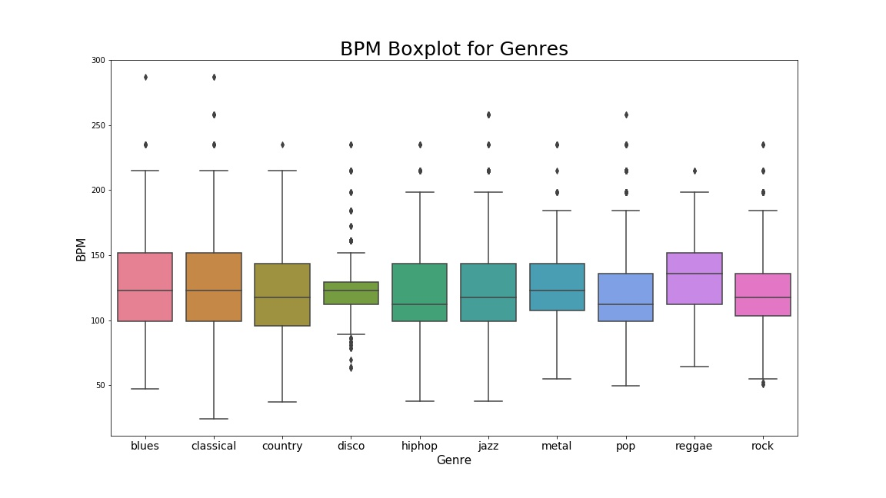

# Music Genre Classification (GTZAN)

Classifying 30-second music clips into 10 genres from hand-crafted audio features, using
[librosa](https://librosa.org/) for signal analysis and a small Keras neural network for
classification. Built as an end-to-end walkthrough: audio exploration → feature engineering →
EDA → model → evaluation.

**Result:** 88.7 % test accuracy on the 3-second-clip feature set (10 classes, 40 % hold-out).

## Dataset

[GTZAN](http://marsyas.info/downloads/datasets.html) — 1 000 tracks, 10 genres
(blues, classical, country, disco, hip-hop, jazz, metal, pop, reggae, rock), 100 tracks each,
30 s per track at 22 050 Hz.

This repository ships the two tabular feature files that the model actually trains on:

| file | rows | description |
|---|---|---|
| `Data/features_30_sec.csv` | 1 000 | 57 features per full 30-second track |
| `Data/features_3_sec.csv` | 9 990 | the same features per 3-second window (10× more training examples) |

The raw `.wav` files are **not** included (≈1.2 GB). They are only needed for the audio-exploration
section of the notebook; download them from the link above (or
[Kaggle](https://www.kaggle.com/datasets/andradaolteanu/gtzan-dataset-music-genre-classification))
and place them under `Data/genres_original/<genre>/`.

## Features

Each row contains the mean and variance of the following per-frame descriptors, plus tempo:

- Chroma STFT, RMS energy, spectral centroid, spectral bandwidth, spectral roll-off, zero-crossing rate
- Harmonic and percussive components (HPSS)
- 20 MFCC coefficients

The notebook visualises how these are computed for individual tracks: waveforms, STFT and mel
spectrograms, zero crossings, spectral centroid/roll-off overlays, MFCC and chroma maps.



*Tempo alone already separates some genres (e.g. disco vs. classical), but most overlap heavily — which is why the full feature set is needed.*

## Model

```
StandardScaler → Dense(256, relu) → Dense(128, relu) → Dense(64, relu) → Dense(10, softmax)
optimizer=adam · loss=sparse_categorical_crossentropy · 500 epochs · batch 64
```

Train/test split: 60 / 40 on `features_3_sec.csv`. A 2-component PCA of the min-max-scaled
features is also plotted to show the (limited) linear separability of the genres.

| metric | value |
|---|---|
| test accuracy | **0.887** |
| test loss | 1.09 |
| train accuracy (epoch 500) | ≈ 0.999 |

The gap between train and test accuracy indicates over-fitting; see *Ideas* below.

## Running it

```bash
git clone https://github.com/RANJITHROSAN17/musicgenre.git
cd musicgenre
python -m venv .venv && source .venv/bin/activate   # Windows: .venv\Scripts\activate
pip install -r requirements.txt
jupyter notebook music_genre_classification.ipynb
```

The feature-based EDA and the model train from the bundled CSVs without any audio download
(roughly 2–3 minutes on CPU for 500 epochs). The first ~60 cells (audio exploration) require the
GTZAN `.wav` files as described above.

## Project structure

```
music_genre_classification.ipynb   exploration, EDA, model training and evaluation
Data/features_30_sec.csv           per-track features (1 000 rows)
Data/features_3_sec.csv            per-3-second-window features (9 990 rows)
docs/bpm_boxplot.jpg               tempo-per-genre plot used above
requirements.txt
```

## Ideas / next steps

- Regularisation (dropout, early stopping, weight decay) to close the train/test gap
- Stratified, seeded split and k-fold cross-validation for a more reliable estimate
- Compare against gradient-boosted trees and an SVM on the same features
- A CNN on mel-spectrogram images (`images_original/` in GTZAN) instead of tabular features
- Confusion matrix to see which genres are confused (rock vs. country is the classic one)

## Acknowledgements

GTZAN dataset by G. Tzanetakis and P. Cook, *Musical genre classification of audio signals*,
IEEE Transactions on Audio and Speech Processing, 2002. Feature CSVs follow the format of the
Kaggle distribution of the dataset.
